# Dastavez (दस्तावेज़)

**Citation-verified question answering over Indian government scheme documents, with a routed OCR
cascade for Hindi (Devanagari) and scanned pages.**

Every answer sentence carries a `(document, page)` citation, a verifier checks that the cited
page actually supports it, and the system answers *"Not found in the documents."* when the
evidence is weak. The hard part on real government PDFs turned out to be getting the text out
at all, so extraction is measured as carefully as retrieval.

> **Status of the numbers.** Retrieval numbers below are real runs on this corpus.
> Extraction numbers are scored against an **AI-transcribed reference set (30 pages, not
> human-verified)**: every sampled page was transcribed by Claude (Anthropic) from the page image,
> without seeing any extractor output. It is not human gold. The annotation tooling supports human
> single or double annotation, which would replace this reference set (see
> [Human annotation](#human-annotation)).

---

## The problem

Scheme guidelines (PM-KISAN, PMAY-U, PM SVANidhi, MGNREGA ...) are where eligibility rules and
amounts live. They are PDFs of three very different kinds:

| Kind | What `pypdf.extract_text()` returns |
|---|---|
| English, born-digital | good text |
| Hindi, born-digital with legacy fonts (Kruti Dev / Chanakya style) | Latin mojibake: `vkoklu vkSj 'kgjh dk;Z ea=ky;` for "आवासन और शहरी कार्य मंत्रालय" |
| Hindi with broken ToUnicode maps | dropped conjuncts and matras: `धानमंी` for "प्रधानमंत्री", U+FFFD |
| Scanned gazettes / letters | nothing, or an old OCR layer like `~V1lR ~C:: Q:he of ~ndio/` |

A RAG system built on the naive text layer silently cannot answer anything from the Hindi and
scanned pages, and an LLM on top will happily answer anyway. Dastavez fixes the input and refuses
to make claims it cannot cite.

## Architecture

```mermaid
flowchart LR
    A[corpus/manifest.json<br/>16 PDFs, SHA-256 pinned] -->|download + verify| B[corpus/pdfs<br/>untrusted input]
    B --> C1[pypdf baseline]
    B --> C2[pdfplumber layout parse<br/>reading order, headings,<br/>tables, page labels]
    C2 --> R{router<br/>per page}
    R -->|text layer OK| K[keep text layer]
    R -->|empty / undecodable /<br/>broken Devanagari /<br/>legacy font / garbled / scan| O[render 300 dpi<br/>Tesseract eng or hin+eng]
    O --> AR{OCR better than<br/>text layer?}
    AR -->|yes| P[page text + route]
    AR -->|no: ocr_rejected| P
    K --> P
    P --> CH[heading-aware chunks<br/>never cross pages]
    CH --> E[multilingual-e5-large<br/>embeddings]
    CH --> L[BM25 / Postgres FTS]
    E --> V[(pgvector HNSW<br/>or in-process)]
    Q[question] --> L & V
    L & V --> F[RRF fusion]
    F --> RR[bge-reranker-v2-m3<br/>cross-encoder]
    RR --> G{evidence gate}
    G -->|weak| NF[Not found in the documents.]
    G -->|ok| GEN[Gemini or extractive<br/>every sentence cites doc+page]
    GEN --> VER[citation verifier<br/>numbers, quotes, token support]
    VER --> ANS[answer + citations + snippets]
```



## Corpus

16 public documents, **378 pages** in total (`corpus/manifest.json` has title, ministry,
language, source URL, SHA-256 and page count for each). The PDFs are not committed;
`dastavez corpus download` fetches them and refuses any file whose hash differs.

| Stratum | Documents | Pages |
|---|---|---:|
| English, born-digital | PM-KISAN operational guidelines (2020) and para 8.1 amendment; PM SVANidhi scheme and loan guidelines; Stand-Up India FAQ and factsheet (PIB); PMAY-U 2.0 guidelines (2024); AB PM-JAY beneficiary identification guidelines; Haryana Rural Employment Guarantee Scheme 2007 (MGNREGA, English gazette) | 219 |
| Hindi, born-digital | PMAY-U 2.0 guidelines (Hindi); PM Ujjwala seven-years factsheet (PIB Hindi); Haryana Rural Employment Guarantee Scheme 2007 (Hindi gazette) | 139 |
| Scanned | PM-KISAN physical verification letter; PMAY-U guideline amendments (Hindi, 2018); MGNREGA Schedule I/II amendment (Gazette of India, bilingual); Haryana unemployment allowance rules 2014 (bilingual) | 20 |

## Results

### Routing (all 378 pages)

| Route | Pages | Reasons |
|---|---:|---|
| `text_layer` (kept) | 207 | text layer passed all checks |
| `ocr` (OCR output accepted) | 157 | legacy-font script mismatch, empty layer, broken Devanagari, scans with an old OCR layer, undecodable glyphs |
| `ocr_rejected` (OCR ran, text layer kept) | 14 | mostly empty / graphic pages where OCR found nothing better |

Reasons across all pages: `text_layer_ok` 207, `script_mismatch_legacy_font` 134,
`empty_text_layer` 23, `scanned_with_text_layer` 8, `broken_devanagari` 3,
`undecodable_glyphs` 2, `garbled_text` 1. OCR: Tesseract 5.5.3 (LSTM, `tessdata_fast` eng + hin).
Full ingestion took 622 s on a laptop CPU. Source: `results/ingest_summary.json`.

### Extraction quality (AI-transcribed reference set, 30 pages, not human-verified)

Mean normalised text similarity (1 = identical) and character error rate against the
AI-transcribed reference set: all 30 pages of the fixed-seed sample, 10 per stratum
(`results/extraction_eval_silver.md`; the code still calls this reference kind `silver`):

| Stratum | n | pypdf sim | layout sim | cascade sim | pypdf CER | cascade CER |
|---|---:|---:|---:|---:|---:|---:|
| english_digital | 10 | 0.894 | 0.895 | 0.954 | 0.115 | 0.078 |
| hindi_digital | 10 | 0.195 | 0.196 | 0.935 | 0.899 | 0.115 |
| scanned | 10 | 0.595 | 0.589 | 0.917 | 0.442 | 0.124 |
| **all** | 30 | **0.561** | 0.560 | **0.935** | 0.485 | 0.106 |

Bootstrap 95% intervals on overall similarity: pypdf 0.41-0.71, cascade 0.90-0.96.

Read this carefully:

* The reference is **AI-transcribed**: one pass plus one self-review pass by Claude (Anthropic)
  reading the rendered page images, without looking at any extractor output. Nobody has verified it
  by hand. An AI transcriber may share error patterns with OCR, which would flatter the cascade.
* On English digital pages pypdf and the cascade agree (similarity above 0.96 on 9 of 10 pages).
  The English gap in the table comes from one flowchart page (`pmsvanidhi_loan_og_en` p22): its
  text layer gives pypdf almost nothing usable (0.03) and OCR is routed in (0.62; the
  reading order of a diagram is a judgment call).
* The gain is concentrated on Hindi and scanned pages, which is where routing sends OCR.
* Weakest cascade pages: the flowchart above, a skewed bilingual scan
  (`haryana_unemployment_allowance_rules_2014` p6, 0.67, where Tesseract dropped lines beside margin
  notes) and a Hindi form table (`pmay_u2_guidelines_2024_hi` p73, 0.80).

### Retrieval and answers

58 questions (`eval/questions.jsonl`): 48 answerable (38 English, 10 Hindi) with gold pages,
10 unanswerable (other schemes, or facts true in the world but absent from these documents).
Page-level metrics; k = 5; e5-large embeddings; bge-reranker-v2-m3 (int8) cross-encoder;
answers are **extractive** (no Gemini key was set), every sentence verified against its cited page.
The not-found threshold is calibrated on a fixed 20% dev split (14 questions) and the
"test" column is the other 80%. Source: `results/retrieval_eval.md`.

| Mode | R@1 | R@3 | R@5 | R@10 | MRR@10 | Citation precision | Answered (answerable Qs) | Not-found acc. (test, n=9) |
|---|---:|---:|---:|---:|---:|---:|---:|---:|
| BM25 only | 0.443 | 0.581 | 0.647 | 0.757 | 0.772 | 0.500 | 0.729 | 0.889 |
| Dense only | 0.477 | 0.722 | 0.791 | 0.858 | 0.873 | 0.597 | 0.646 | 1.000 |
| Hybrid (RRF) | 0.495 | 0.647 | 0.745 | 0.816 | 0.871 | 0.524 | 0.729 | 0.889 |
| **Hybrid + rerank** | **0.575** | **0.798** | **0.848** | **0.867** | **0.953** | **0.667** | **1.000** | **1.000** |

Recall@5 by question language (hybrid + rerank): English 0.900, Hindi 0.650.

What this shows, honestly:

* The cross-encoder reranker is the biggest single win (R@5 0.745 -> 0.848, MRR 0.871 -> 0.953).
* **Plain RRF hybrid is worse than dense-only here** (R@5 0.745 vs 0.791): BM25 is weak on this
  corpus (Hindi OCR text, paraphrased questions) and equal-weight fusion lets it pull in noise.
  Hybrid still helps once the reranker re-orders the fused pool.
* Citation precision is page-level and strict: answers often cite a neighbouring page of the
  right section (or a parallel page in the other language) that is not in the gold list.
* "Answered" is the share of answerable questions that were *not* refused. With only 10
  unanswerable questions (1 in the dev split), the abstention numbers have very wide uncertainty.
* The verifier kept 100% of extractive sentences (by construction they are quoted from the page);
  its value shows with a generator, which is unit-tested but not benchmarked here.
* Seconds per query on a laptop CPU: BM25 0.002 s, dense 0.2 s, hybrid + rerank 11.9 s
  (20 cross-encoder pairs, CPU ONNX).

**Calibration change, disclosed.** The first run (`results/archive/retrieval_eval_run1_edge_threshold.md`)
picked the first threshold that maximised dev balanced accuracy, which put the cross-encoder
gate at 0.99, exactly on the lowest dev positive; on the test split that refused 29% of
answerable questions (Answered 0.708, citation precision 0.711). The calibration was changed to
the standard max-margin rule (midpoint of the widest gap among equally good cuts, gate 0.572)
and re-run; retrieval metrics are unchanged, only the answer/abstention columns moved.
Both runs are kept.

#### Ablation: the same pipeline on raw pypdf text

Same questions, models and procedure, but the index is built from `pypdf` page text instead of
the cascade (`results/retrieval_eval_pypdf.md`):

| Mode | R@5 cascade | R@5 pypdf | MRR@10 cascade | MRR@10 pypdf | Hindi R@5 cascade | Hindi R@5 pypdf |
|---|---:|---:|---:|---:|---:|---:|
| BM25 only | 0.647 | 0.594 | 0.772 | 0.581 | 0.521 | 0.300 |
| Dense only | 0.791 | 0.714 | 0.873 | 0.819 | 0.629 | 0.596 |
| Hybrid (RRF) | 0.745 | 0.660 | 0.871 | 0.796 | 0.596 | 0.546 |
| Hybrid + rerank | 0.848 | 0.785 | 0.953 | 0.913 | 0.650 | 0.533 |

Hindi questions' gold pages include the parallel English pages where the same fact exists
(PMAY-U 2.0 and the Haryana scheme have both versions), so the pypdf index can still score on
them through the English documents; the gap is largest for BM25, which has no cross-lingual path.

**Downstream effect of the OCR cascade** (same questions, same models, index built from raw
pypdf text instead; `results/retrieval_eval_pypdf.md`):

| Index text | Hybrid + rerank R@5 | MRR@10 | Hindi-question R@5 | BM25 Hindi R@5 |
|---|---:|---:|---:|---:|
| pypdf | 0.785 | 0.913 | 0.533 | 0.300 |
| routed OCR cascade | 0.848 | 0.953 | 0.650 | 0.521 |

Hindi questions still find some answers on the pypdf index because their gold pages include
the parallel pages of the English PMAY-U / Haryana documents, which the multilingual dense
model can reach cross-lingually; Hindi-only documents (PM Ujjwala, the 2018 amendments) are
unreachable without OCR.

## Human annotation

The sample is a stratified, fixed-seed set of 30 pages (`gold/sample.json`, seed 20261016,
10 per stratum, blank pages excluded). The current reference for these pages is the AI-transcribed
set in `gold/silver/` (see `gold/silver/README.md`). The annotation tooling supports human single or
double annotation, which would replace this reference set; with two annotators the workflow is:

```bash
dastavez gold prepare       # renders gold/pages/*.png, creates empty gold/annotator_{a,b}/*.txt
# ... both annotators transcribe, following docs/ANNOTATION_GUIDE.md ...
dastavez gold agree         # inter-annotator similarity + CER per stratum -> results/annotation_agreement.json
dastavez gold adjudicate    # identical pages -> gold/final/; others -> gold/adjudication/<id>.md word diffs
dastavez eval-extraction    # scores pypdf / layout / cascade against gold/final/ (falls back to gold/silver/)
```

A single annotator can instead save corrected transcriptions directly to `gold/final/`. Agreement is reported as similarity and CER *between annotators*, which is the noise floor for
every extraction number. Disagreements are resolved against the page image into `gold/final/`.
`docs/ANNOTATION_GUIDE.md` has the transcription rules (matras, conjuncts, numerals, tables,
headers, margin notes).

## Reproduce

Requires Python 3.11+, and Tesseract 5 with `eng` + `hin` traineddata for OCR.

```bash
python -m venv .venv && . .venv/bin/activate      # Windows: .venv\Scripts\activate
pip install -e ".[all]"
cp .env.example .env                              # optional: DATABASE_URL, GEMINI_API_KEY, TESSERACT_CMD

dastavez corpus download                          # 16 PDFs, SHA-256 verified
dastavez ingest                                   # parse + route + OCR + chunk + embed + index
dastavez index --text-source pypdf                # (optional) ablation index on raw pypdf text
dastavez eval-extraction                          # -> results/extraction_eval_*.{json,md}
dastavez eval-retrieval                           # -> results/retrieval_eval.{json,md}, calibration.json
dastavez eval-retrieval --text-source pypdf       # -> results/retrieval_eval_pypdf.{json,md}
dastavez ask "What is the minimum carpet area under PMAY-U 2.0?"
dastavez serve                                    # http://127.0.0.1:8000  (POST /ask, GET /)
```

`POST /ask` body: `{"question": "...", "mode": "hybrid_rerank", "k": 5}`; the response contains
the answer, per-sentence citations with page snippets and source URLs, dropped sentences and the
evidence-gate value.

### What runs where

| Component | Used here | Fallback |
|---|---|---|
| OCR | Tesseract 5.5.3 (UB Mannheim build), `eng` + `hin` from `tessdata_fast` | route recorded as `ocr_unavailable`, text layer kept |
| Embeddings | `intfloat/multilingual-e5-large` via fastembed (ONNX, CPU) | Gemini `gemini-embedding-001` with `GEMINI_API_KEY`; deterministic hashing embedder (tests/CI) |
| Reranker | `BAAI/bge-reranker-v2-m3` int8 ONNX via fastembed | lexical coverage reranker |
| Store | in-process BM25 + numpy | PostgreSQL + pgvector HNSW + full-text search when `DASTAVEZ_DATABASE_URL` is set |
| Generation | extractive (no Gemini key was set for the reported runs) | Gemini when `GEMINI_API_KEY` is set; output still verified |

### Environment notes (Windows dev machine)

* Python 3.14 venv. PyMuPDF and scikit-learn 1.9.1 wheels are blocked by Windows Smart App
  Control on this machine, so the project depends on neither (pdfplumber + pypdfium2 for PDFs).
* Tesseract installed without admin rights to `E:\tools\tesseract` (set `TESSERACT_CMD`), `hin`
  traineddata copied from `tessdata_fast`.
* No Docker or local Postgres: the pgvector tests are skipped locally and run in CI against the
  `pgvector/pgvector:pg16` service container.
* A larger multilingual reranker (`jina-reranker-v2-base-multilingual`) failed to load
  (ONNX Runtime "bad allocation"), hence bge-reranker-v2-m3 int8.

## Tests and CI

`pytest` covers routing heuristics, Devanagari detection, chunking keeps page numbers, BM25 and
RRF against hand-computed values, the citation verifier (supported vs. unsupported), evaluation
metrics against hand-computed values, annotation agreement / adjudication, retrieval and the API,
plus OCR (Tesseract) and pgvector integration tests. GitHub Actions runs `ruff check`,
`ruff format --check` and `pytest` on Python 3.11, 3.12 and 3.13 with `tesseract-ocr-hin` installed
and a pgvector service container.

**72 tests.** Locally (Windows, Tesseract installed, no Postgres): 68 passed, 4 skipped (the
pgvector integration tests). In CI the 4 pgvector tests run against the service container and the
1 real-corpus routing test is skipped (PDFs are not in the repo).

## Limitations

* Extraction results are measured against an AI-transcribed reference set (30 pages, not
  human-verified), which could share error patterns with OCR. Human single or double annotation,
  supported by the tooling, would replace it.
* 58 evaluation questions, drafted by the builder (with an AI assistant) from the documents and
  awaiting owner review; wording overlap with the source favours lexical retrieval. 10 are
  unanswerable, so the not-found accuracy has very wide uncertainty.
* The verifier is a lexical proxy (numbers, quotes, token overlap), not an entailment model; it
  will not catch a flipped negation.
* Reported answers are extractive; the Gemini path is unit-tested with a fake generator but not benchmarked.
* Tesseract `tessdata_fast` on CPU; skewed or two-column scans still lose lines. No deskewing yet.
* Postgres full-text ranking (`ts_rank_cd`) is not BM25; reported retrieval numbers use the in-process BM25.
* 16 documents is a deliberately hard sample, not a complete scheme library.

## Repository layout

```
corpus/manifest.json        document list with SHA-256 and page counts (PDFs are downloaded, not committed)
src/dastavez/               parse, routing, ocr, ingest, chunking, lexical (BM25/RRF), embeddings,
                            rerank, store (memory/pgvector), retrieve, answer, verify, metrics,
                            annotation, eval_extraction, eval_retrieval, cli, api, web/index.html
eval/questions.jsonl        58 questions with gold pages (48 answerable, 10 unanswerable)
gold/                       sample.json, annotator_a/, annotator_b/, silver/ (AI-transcribed reference, 30 pages), final/ (human, after adjudication)
results/                    ingest summary, extraction and retrieval evaluation outputs
docs/                       ANNOTATION_GUIDE.md, INTERVIEW_GUIDE.md
tests/                      pytest suite
```

## License

MIT, see [LICENSE](LICENSE). The scheme documents belong to their publishers and are fetched
from the URLs in the manifest; they are not redistributed here.
